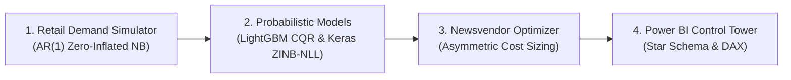
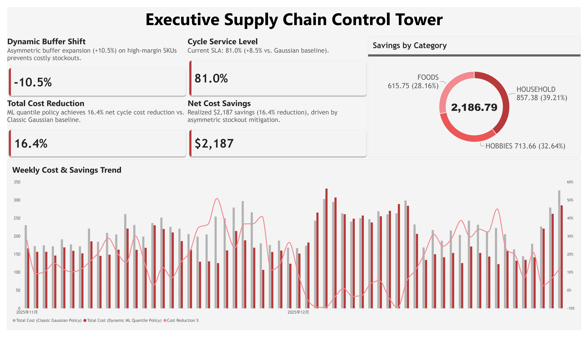
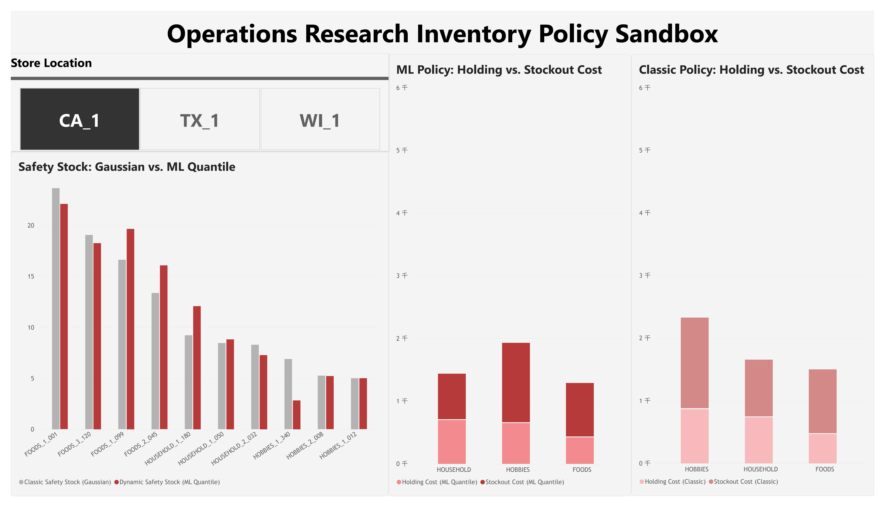

# Supply Chain Resilience Control Tower
### End-to-End Probabilistic Demand Forecasting & Newsvendor Inventory Engine

[](https://www.python.org/)
[](https://lightgbm.readthedocs.io/)
[](https://www.tensorflow.org/)
[](https://powerbi.microsoft.com/)

Point forecasts paired with normal-distribution safety stock formulas often misprice stockouts against holding costs when retail demand is skewed, seasonal, or zero-inflated. This project connects **probabilistic forecasting**, **asymmetric Newsvendor optimization**, and a **4-page Power BI control tower** on an M5-calibrated 2-year benchmark (`22,260` transactions across 10 SKUs and 3 stores).



---

## Control Tower Showcase

### 1. Executive Overview
Tracks net cost savings (`$2,187` / `-16.4%`), Cycle Service Level (`81.0%`), category savings mix, and daily cost trends across the 60-day test window.



### 2. Probabilistic Demand & Uncertainty Funnel
Overview summarizes per-SKU prediction spread alongside model medians; drilling into a store and SKU (`CA_1` + `FOODS_1_001`) reveals the adaptive P10–P90 demand interval around surges.


### 3. Newsvendor Policy Sandbox
Compares safety stock allocation and holding vs. stockout cost trade-offs against Classic Gaussian rules globally and under store-level filtering (`CA_1`).




### 4. Model Governance & Decision Attribution
Pairs global TreeSHAP feature attribution (seasonality, recent sales momentum, store/SKU effects, and promotions) with a category-to-SKU drill-down matrix for planner sign-off.


---

## Model & Policy Evaluation

Evaluated chronologically on the final 60-day holdout horizon (`1,800` records across 30 series; two-sided date-clustered Diebold-Mariano tests vs. Croston-SBA):

| Model Architecture | Category | MAE (P50) | RMSE (Mean) | Avg Pinball Loss | DM Stat (p-value) | Training Time |
| :--- | :--- | :---: | :---: | :---: | :---: | :---: |
| **Croston-SBA Baseline** | Operations Research | 4.272 | 6.510 | 1.355 | — | 0.36s |
| **MA-7d Baseline** | Operations Research | 4.442 | 6.778 | 1.416 | -3.25 (1.94e-03) | 0.02s |
| **LightGBM Quantile** | Tree-based GBDT | **3.688** | **5.820** | 1.186 | **8.61 (5.11e-12)** | 1.55s |
| **Deep Probabilistic (ZINB-NLL)** | TensorFlow/Keras NN | 3.717 | 5.929 | **1.177** | **7.25 (1.00e-09)** | 21.27s |

### Lead-Time Inventory Ablation (60-Day Holdout)

| Policy | Total Cost | Savings vs. Classic | Cycle SLA (Type-1) |
| :--- | :---: | :---: | :---: |
| **1. Classic Gaussian (MA-28d)** | \$13,319.34 | — | 72.5% |
| **2. Croston-SBA (NB Quantile)** | \$12,680.09 | \$639.25 (4.8%) | 76.9% |
| **3. ML Mean + Gaussian SS (Ablation)** | \$11,154.85 | \$2,164.49 (16.2%) | 80.3% |
| **4. Direct ML CQR Quantile Policy** | **\$11,132.55** | **\$2,186.79 (16.4%)** | **81.0%** |

**Design Takeaway**: Most financial gain comes from replacing trailing averages with conditional ML demand forecasts (`$2,164` captured at `ML Mean + Gaussian`), while conformal quantile sizing reallocates buffer toward high-stockout-cost SKUs to lift Cycle SLA from `72.5%` to `81.0%`.  
*(Note: Synthetic Nov–Dec holdout benchmark evaluated on cycle-normalized $L$-day Newsvendor windows; `Deep ZINB-NLL` benchmarks 1-day density accuracy while CQR LightGBM powers lead-time optimization and TreeSHAP. An independent daily stateful simulation confirmed `+10.95%` cost reduction under lost sales and `+20.96%` under backorders.)*

---

## Project Structure & Quickstart

```text
├── src/
│   ├── data_pipeline/       # Synthetic AR(1) NB demand generator & lag/calendar features
│   ├── models/              # Croston-SBA/MA7, CQR LightGBM, TensorFlow ZINB-NLL, DM eval
│   ├── inventory_engine/    # Asymmetric Newsvendor optimizer & Star Schema CSV exporter
│   └── explainability/      # TreeSHAP lead-time feature attribution
├── powerbi/                 # DAX measure library, layout guide, & exported Star Schema CSVs
├── tests/test_pipeline.py   # End-to-end data contract, monotonicity, & ablation tests
└── run_pipeline.py          # Single-entry orchestrator
```

```bash
pip install -r requirements.txt
python run_pipeline.py
python tests/test_pipeline.py
```

*Open [`supply-chain.pbix`](supply-chain.pbix) in Power BI Desktop to explore the live report.*
