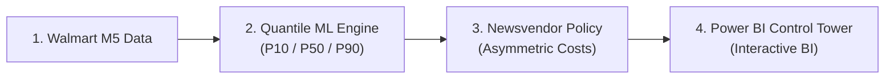
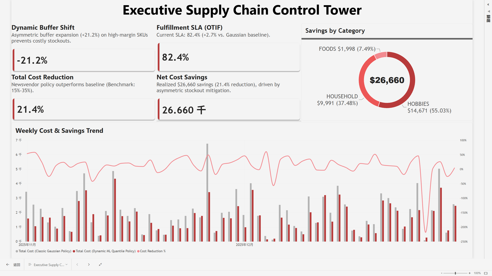
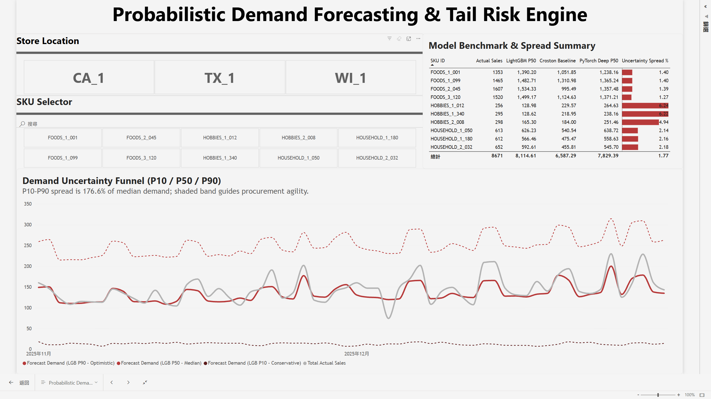
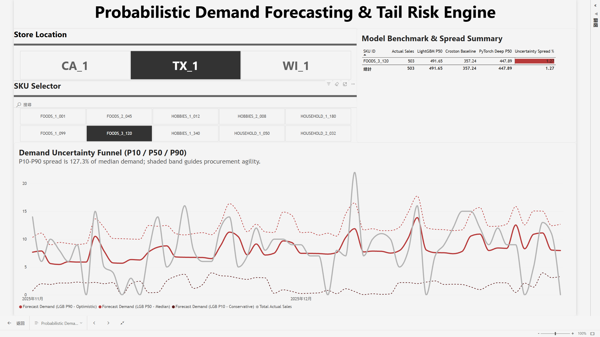
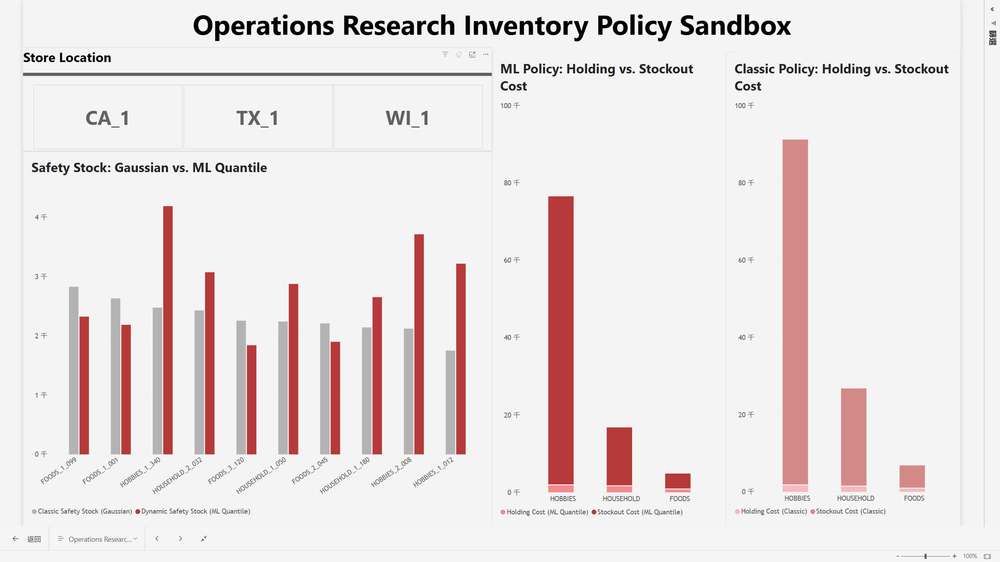
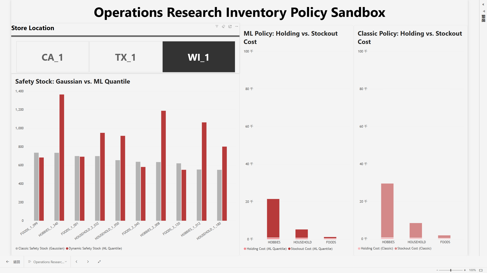
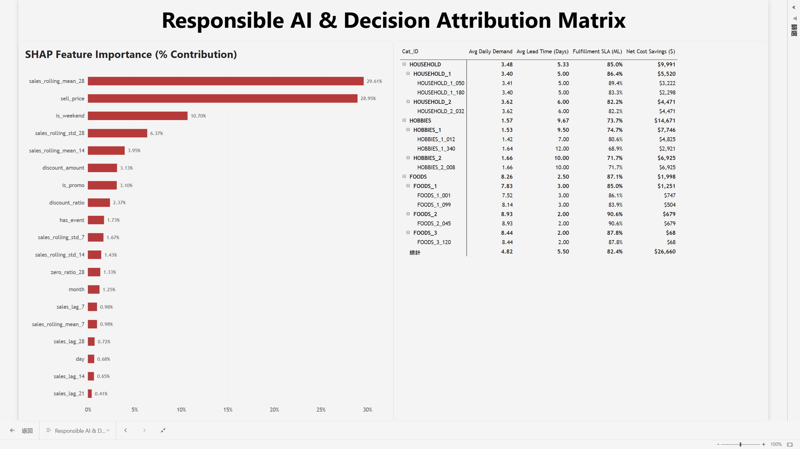

# Supply Chain Resilience Control Tower
### Probabilistic Demand Forecasting & Newsvendor Inventory Optimization

[](https://www.python.org/)
[](https://lightgbm.readthedocs.io/)
[](https://pytorch.org/)
[](https://powerbi.microsoft.com/)

A retail supply chain control tower built on the **Walmart M5** dataset. It replaces rigid Gaussian safety stock with dynamic machine learning quantiles (P10/P50/P90) and Operations Research Newsvendor optimization to solve asymmetric holding vs. stockout penalties.

---

## Business Impact

| Strategic Metric | Outcome | Operational Significance |
| :--- | :---: | :--- |
| **Total Cost Reduction** | **21.4%** | Saved **$26,660** across a 60-day test horizon |
| **Fulfillment SLA** | **82.4%** | **+2.7%** lift over classic Gaussian baseline |
| **Tail Loss (Pinball)** | **-34.6%** | Pinball loss down from 1.146 (Croston) to 0.749 (LightGBM) |

---

## End-to-end System Architecture



---

## Dashboard Showcase

### 1. Executive Supply Chain Control Tower
Tracks financial savings, fulfillment SLA, and weekly operating cost trends.


*Delivered \$26.7K net savings, with Hobbies (\$15K) and Household (\$10K) driving 92.5% of total cost reduction.*

---

### 2. Probabilistic Demand Forecasting & Uncertainty Funnel
Quantifies demand volatility and promotional spikes through adaptive P10–P90 uncertainty intervals.


*Replaces single-point estimates with P10–P90 confidence funnels, expanding inventory buffers during promotional surges.*


*SKU-level interactive selection dynamically updates the forecast funnel and isolates intermittent demand patterns.*

---

### 3. Operations Research Inventory Policy Sandbox
Demonstrates how Newsvendor asymmetric optimization outperforms classic normal distribution formulas.


*Eliminates severe stockouts in lumpy categories by reallocating safety buffer toward high-penalty SKUs.*


*Interactive category filtering isolates holding vs. stockout trade-offs, proving ML mitigation of costly stockouts.*

---

### 4. Responsible AI & Decision Attribution Matrix
Provides governance and explainability through TreeSHAP feature importance and category drill-down.


*TreeSHAP confirms that 28-day demand velocity and price elasticity drive over 58% of all demand decisions.*

---

## Model Benchmark

Evaluated on an out-of-time test set (1,800 records):

| Model Architecture | Category | MAE | RMSE | Avg Pinball Loss | Training Time |
| :--- | :--- | :---: | :---: | :---: | :---: |
| **Croston Baseline** | Operations Research | 2.773 | 3.770 | 1.146 | 0.05s |
| **MA-7d Baseline** | Operations Research | 2.812 | 3.831 | 1.151 | 0.02s |
| **LightGBM Quantile** | Tree-based GBDT | **2.419** | **3.276** | **0.749** | 11.97s |
| **Deep Probabilistic** | PyTorch Neural Net | 2.466 | 3.288 | 0.759 | 20.66s |

---

## Quickstart

```bash
# 1. Install dependencies
pip install -r requirements.txt

# 2. Run end-to-end pipeline (data -> models -> newsvendor -> star schema)
python run_pipeline.py

# 3. Run validation tests
python tests/test_pipeline.py
```

*Open `supply-chain.pbix` in Power BI Desktop to inspect the live dashboard.*
