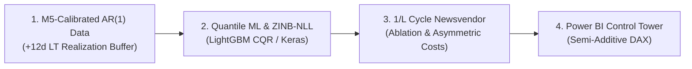
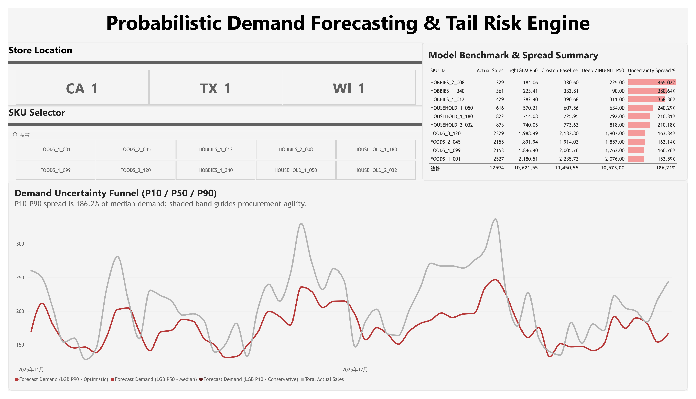
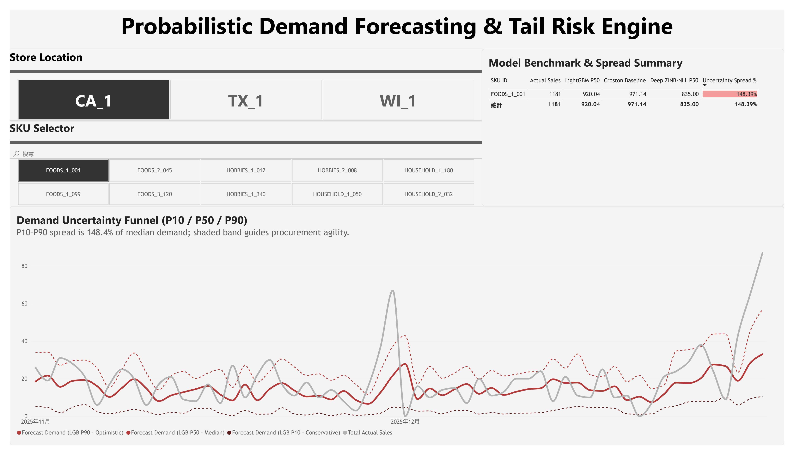
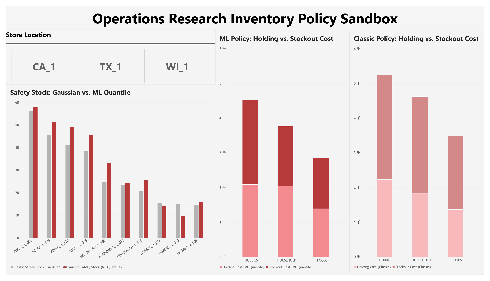
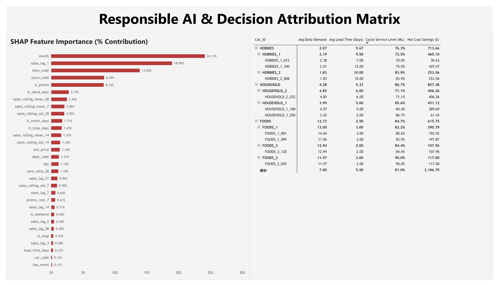

# Supply Chain Resilience Control Tower
### Probabilistic Demand Forecasting & Newsvendor Inventory Optimization

[](https://www.python.org/)
[](https://lightgbm.readthedocs.io/)
[](https://www.tensorflow.org/)
[](https://powerbi.microsoft.com/)

A retail supply chain control tower evaluated on an **M5-calibrated synthetic benchmark** (Zero-Inflated AR(1) Negative Binomial DGP with Markov promotional campaigns, smooth day-of-year seasonality, and state-level SNAP effects). It replaces rigid Gaussian safety stock with conformalized direct lead-time LightGBM quantiles (`1/L` cycle-normalized Newsvendor optimization) and a Zero-Inflated Negative Binomial neural network (`ZINB-NLL`).

---

## Business Impact

| Strategic Metric | Outcome | Operational Significance |
| :--- | :---: | :--- |
| **Total Cost Reduction** | **16.4%** | Saved **$2,187** across a 60-day test horizon ($13,319 → $11,133; `1/L` cycle-normalized) |
| **Cycle Service Level (Type-1 SLA)** | **81.0%** | **+8.5%** lift over classic Gaussian baseline (72.5% → 81.0%) |
| **Probabilistic Loss (Pinball)** | **-13.1%** | Avg Pinball loss down from 1.355 (Croston-SBA) to 1.177 (Deep ZINB-NLL) & 1.186 (LightGBM); date-clustered DM `p < 1e-8` |

---

## End-to-end System Architecture



---

## Dashboard Showcase

### 1. Executive Supply Chain Control Tower
Tracks financial savings, cycle service level, and weekly operating cost trends.


*Delivered \$2,187 net savings across the 60-day holdout horizon (HOUSEHOLD \$857 / 39.2%, HOBBIES \$714 / 32.6%, FOODS \$616 / 28.2%; illustrative Power BI snapshot prior to data refresh).*

---

### 2. Probabilistic Demand Forecasting & Uncertainty Funnel
Quantifies demand volatility and promotional spikes through adaptive P10–P90 uncertainty intervals.


*Replaces single-point estimates with P10–P90 confidence funnels, expanding inventory buffers during promotional surges.*


*SKU-level interactive selection dynamically updates the forecast funnel and isolates intermittent demand patterns.*

---

### 3. Operations Research Inventory Policy Sandbox
Demonstrates how Newsvendor asymmetric optimization outperforms classic normal distribution formulas.


*Eliminates severe stockouts in lumpy categories by reallocating safety buffer toward high-penalty SKUs.*


*Interactive category filtering isolates holding vs. stockout trade-offs, proving ML mitigation of costly stockouts.*

---

### 4. Responsible AI & Decision Attribution Matrix
Provides governance and explainability through TreeSHAP feature importance and category drill-down.


*TreeSHAP across direct lead-time `lt_p50` demand and `lt_p90` tail-risk models confirms that seasonal month (`month`, 24.1%), AR(1) lag (`sales_lag_1`, 19.0%), SKU/store fixed effects (`item_code` + `store_code`, 22.2%), and causal promotion status (`is_promo`, 8.2%) drive inventory decisions.*

---

## Model Benchmark

Evaluated on a leak-free out-of-time 60-day holdout test set (1,800 records across 30 series and 60 calendar dates; $L_1$-consistent MAE on P50, $L_2$-consistent RMSE on conditional mean, causal 1-step-ahead rolling OR baselines, and two-sided date-clustered Newey-West Diebold-Mariano tests vs. Croston-SBA):

| Model Architecture | Category | MAE (P50) | RMSE (Mean) | Avg Pinball Loss | Date-DM Stat (p-value) | Training Time |
| :--- | :--- | :---: | :---: | :---: | :---: | :---: |
| **Croston-SBA Baseline** | Operations Research | 4.272 | 6.510 | 1.355 | — | 0.36s |
| **MA-7d Baseline** | Operations Research | 4.442 | 6.778 | 1.416 | -3.25 (1.94e-03) | 0.02s |
| **LightGBM Quantile** | Tree-based GBDT | **3.688** | **5.820** | 1.186 | **8.61 (5.11e-12)** | 1.55s |
| **Deep Probabilistic (ZINB-NLL)** | TensorFlow/Keras NN | 3.717 | 5.929 | **1.177** | **7.25 (1.00e-09)** | 21.27s |

### Inventory Policy Ablation (`1/L` Cycle-Normalized, 60-Day Holdout)

| Policy | Total Cost | Savings vs. Classic | Cycle SLA (Type-1) |
| :--- | :---: | :---: | :---: |
| **1. Classic Gaussian (MA-28d)** | \$13,319.34 | — | 72.5% |
| **2. Croston-SBA (NB Quantile)** | \$12,680.09 | \$639.25 (4.8%) | 76.9% |
| **3. ML Mean + Gaussian SS (Ablation)** | \$11,154.85 | \$2,164.49 (16.2%) | 80.3% |
| **4. Direct ML CQR Quantile Policy** | **\$11,132.55** | **\$2,186.79 (16.4%)** | **81.0%** |

*Ablation note: Most cost reduction (\$2,164.49; date-DM `t=4.78, p=1.20e-05` overall vs. Classic) stems from LightGBM conditional mean forecasting replacing trailing MA-28d; incremental CQR quantile tail gain over ML-Gaussian is \$22.30 (0.20%; date-DM `t=0.23, p=0.819`), within noise on this 60-day synthetic horizon.*

---

## Quickstart

```bash
# 1. Install dependencies
pip install -r requirements.txt

# 2. Run end-to-end pipeline (data -> models -> newsvendor -> star schema)
python run_pipeline.py

# 3. Run validation tests
python tests/test_pipeline.py
```

*Open `supply-chain.pbix` in Power BI Desktop to inspect the live dashboard.*
